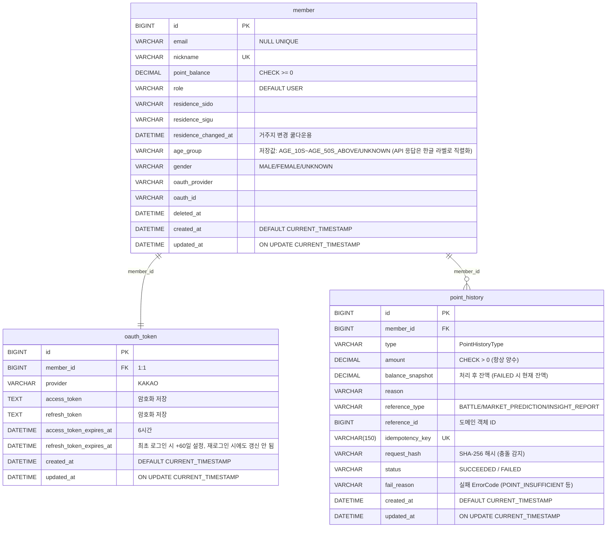

# Member-Point Service ERD

> Member-Point Service의 데이터베이스 설계이다.
> 전체 서비스 ERD 개요는 `docs/ERD.md`를 참조한다.

---

## 1. 테이블 목록

| 테이블 | 설명 |
|---|---|
| `member` | 회원 정보, 포인트 잔액 |
| `oauth_token` | 카카오 OAuth 토큰 (access/refresh) |
| `point_history` | 포인트 적립/차감/정산 이력 |
| `point_outbox_event` | Market으로 보낼 포인트 적립 결과 이벤트 outbox. Debezium CDC로 Kafka 발행 (도입 예정) |

---

## 2. 테이블 DDL

### 2-1. member

```sql
CREATE TABLE member (
    id                   BIGINT          NOT NULL AUTO_INCREMENT,
    email                VARCHAR(255)    NULL UNIQUE,
    nickname             VARCHAR(50)     NOT NULL UNIQUE,
    point_balance        DECIMAL(10,2)   NOT NULL DEFAULT 0.00 CHECK (point_balance >= 0),
    role                 VARCHAR(20)     NOT NULL DEFAULT 'USER',
    residence_sido       VARCHAR(50),
    residence_sigu       VARCHAR(50),
    residence_changed_at DATETIME,
    age_group            VARCHAR(10),                                 -- 연령대. 저장값은 enum name(AGE_10S/AGE_20S/AGE_30S/AGE_40S/AGE_50S_ABOVE/UNKNOWN), API 응답 시 @JsonValue로 한글 라벨(10대/20대/.../50대 이상)로 직렬화됨
    gender               VARCHAR(10),                                 -- 성별 (MALE/FEMALE/UNKNOWN)
    oauth_provider       VARCHAR(20)     NOT NULL,
    oauth_id             VARCHAR(255)    NOT NULL,
    deleted_at           DATETIME,
    created_at           DATETIME        NOT NULL DEFAULT CURRENT_TIMESTAMP,
    updated_at           DATETIME        NOT NULL DEFAULT CURRENT_TIMESTAMP ON UPDATE CURRENT_TIMESTAMP,
    PRIMARY KEY (id),
    UNIQUE KEY uq_oauth (oauth_provider, oauth_id)
);
```

### 2-2. oauth_token

```sql
CREATE TABLE oauth_token (
    id                       BIGINT      NOT NULL AUTO_INCREMENT,
    member_id                BIGINT      NOT NULL UNIQUE,
    provider                 VARCHAR(20) NOT NULL,
    access_token             TEXT        NOT NULL,
    refresh_token            TEXT        NOT NULL,
    access_token_expires_at  DATETIME    NOT NULL,
    refresh_token_expires_at DATETIME    NOT NULL,
    created_at               DATETIME    NOT NULL DEFAULT CURRENT_TIMESTAMP,
    updated_at               DATETIME    NOT NULL DEFAULT CURRENT_TIMESTAMP ON UPDATE CURRENT_TIMESTAMP,
    PRIMARY KEY (id),
    FOREIGN KEY (member_id) REFERENCES member(id)
);
```

### 2-3. point_history

```sql
CREATE TABLE point_history (
    id                  BIGINT          NOT NULL AUTO_INCREMENT,
    member_id           BIGINT          NOT NULL,
    type                VARCHAR(50)     NOT NULL,                    -- PointHistoryType (방향 구분)
    amount              DECIMAL(10,2)   NOT NULL CHECK (amount > 0), -- 항상 양수 (실패 기록 시에도 시도한 금액 저장)
    balance_snapshot    DECIMAL(10,2)   NOT NULL,                    -- 처리 후 잔액 (FAILED 시 변경 없는 현재 잔액)
    reason              VARCHAR(255),
    reference_type      VARCHAR(50)     NULL,                        -- PointReferenceType (BATTLE / MARKET_PREDICTION / INSIGHT_REPORT)
    reference_id        BIGINT          NULL,                        -- 해당 도메인 객체의 ID
    idempotency_key     VARCHAR(150)    UNIQUE,                      -- 중복 처리 방지 (Market 정산/환불 키 길이 대응)
    request_hash        VARCHAR(64)     NULL,                        -- SHA-256(memberId+type+amount+referenceType+referenceId) 충돌 감지용
    status              VARCHAR(20)     NOT NULL DEFAULT 'SUCCEEDED', -- SUCCEEDED / FAILED (포인트 차감 실패 이력 추적용)
    fail_reason         VARCHAR(50)     NULL,                        -- 실패 사유 ErrorCode (예: POINT_INSUFFICIENT). status=SUCCEEDED이면 NULL
    created_at          DATETIME        NOT NULL DEFAULT CURRENT_TIMESTAMP,
    updated_at          DATETIME        NOT NULL DEFAULT CURRENT_TIMESTAMP ON UPDATE CURRENT_TIMESTAMP,
    PRIMARY KEY (id),
    FOREIGN KEY (member_id) REFERENCES member(id)
);

-- 인덱스
CREATE INDEX idx_point_history_member_id ON point_history(member_id);
CREATE INDEX idx_point_history_created_at ON point_history(created_at);
CREATE INDEX idx_point_history_type ON point_history(type);
CREATE INDEX idx_point_history_idempotency_key ON point_history(idempotency_key);
CREATE INDEX idx_point_history_reference ON point_history(reference_type, reference_id);
```

### 2-4. point_outbox_event

> 도입 예정. 설계 근거와 이벤트 스키마는 `docs/architecture/ASYNC_POINT_FLOW.md` §8~§9를 따른다.

Market 포인트 적립 요청 이벤트(`market.point-requests`)를 처리한 트랜잭션에서, `point_history` 기록과 함께 결과 이벤트를 기록한다.
Debezium Outbox Event Router가 `memberpoint.point-results` 토픽으로 발행한다.

```sql
CREATE TABLE point_outbox_event (
    id              BIGINT          NOT NULL AUTO_INCREMENT,
    event_id        CHAR(36)        NOT NULL,
    aggregate_type  VARCHAR(50)     NOT NULL,   -- 'point-results' → memberpoint.point-results
    aggregate_id    VARCHAR(50)     NOT NULL,   -- Kafka message key = market_id
    event_type      VARCHAR(80)     NOT NULL,   -- POINT_CREDITED, POINT_CREDIT_FAILED
    payload         JSON            NOT NULL,   -- envelope 전체 (contracts/events/memberpoint.point-results.v1.schema.json)
    created_at      DATETIME(3)     NOT NULL,
    PRIMARY KEY (id),
    UNIQUE KEY uq_point_outbox_event_event_id (event_id),
    INDEX idx_point_outbox_event_created_at (created_at)
);
```

- INSERT만 하고 UPDATE하지 않는다. 일정 기간 보존 후 주기적으로 삭제한다.
- 이미 처리된 요청(`ALREADY_PROCESSED`)을 다시 받아도 결과 이벤트를 다시 기록한다. Market 쪽 반영은 멱등하다.

---

## 3. ERD 다이어그램



---

## 4. Enum 정의

### 4-1. MemberRole

```java
public enum MemberRole {
    USER,   // 일반 사용자
    ADMIN   // 관리자
}
```

### 4-2. PointHistoryType

```java
public enum PointHistoryType {
    // 적립 (EARN)
    EARN_SIGNUP,            // 신규 가입 보상
    EARN_VOTE,              // Battle 투표 참여 보상
    EARN_VOTE_WIN,          // Battle 승리 진영 추가 보상
    EARN_COMMENT,           // Battle 댓글 작성 보상
    EARN_BATTLE_APPROVED,   // Battle 주제 등록 승인 보상

    // 차감 (SPEND)
    SPEND_MARKET,           // Market 예측 참여
    SPEND_INSIGHT,          // Insight 열람
    SPEND_BATTLE_CREATE,    // Battle 주제 생성권
    SPEND_SLOT,             // 관심 지역 슬롯 확장

    // 정산 (SETTLE)
    SETTLE_MARKET,          // Market 정산 보상
    REFUND_MARKET,          // Market 무효 환불
    REFUND_INSIGHT,         // AI 리포트 생성 실패 환불

    // 시스템
    BURN                    // 소각 (소수점 처리)
}
```

### 4-3. PointReferenceType

```java
public enum PointReferenceType {
    BATTLE,             // Battle 도메인 (reference_id = battleId)
    MARKET_PREDICTION,  // Market Prediction 도메인 (reference_id = predictionId)
    INSIGHT_REPORT      // Insight Report 도메인 (reference_id = reportId)
}
```

| reference_type | reference_id 의미 | 사용 상황 |
|---|---|---|
| `BATTLE` | battle.id | 투표/댓글/주제 승인 보상, 주제 생성권 차감 |
| `MARKET_PREDICTION` | market_prediction.id | Market 예측 참여/정산/환불 |
| `INSIGHT_REPORT` | insight_report.id | Insight 열람 차감, AI 생성 실패 환불 |

---

## 5. 비즈니스 제약

| 항목 | 내용 |
|---|---|
| point_balance | 음수 불가 (CHECK 제약) |
| amount | 항상 양수 (CHECK 제약), 방향은 type으로 구분 |
| idempotency_key | UNIQUE 제약, 중복 처리 방지 |
| reference_type | PointReferenceType enum 값만 허용 (BATTLE / MARKET_PREDICTION / INSIGHT_REPORT) |
| reference_id | reference_type과 함께 사용, 해당 도메인 객체의 ID |
| request_hash | SHA-256(memberId + type + amount + referenceType + referenceId) |
| 거주지 변경 | 30일마다 1회 (residence_changed_at으로 추적) |
| age_group | 카카오 birthyear 기반 계산, 미제공 시 UNKNOWN |
| gender | 카카오 gender 기반 저장 (male→MALE, female→FEMALE, 미제공→UNKNOWN) |
| soft delete | deleted_at 설정, 물리 삭제 금지 |
| 토큰 저장 | access_token, refresh_token 암호화 필수 |
| oauth_token.refresh_token_expires_at | 최초 로그인 시 1회 +60일로 설정되고 이후 재로그인 시에도 연장되지 않음. 현재 어떤 비즈니스 로직도 이 컬럼 값을 읽어 검증하지 않음(우리 서비스 자체 JWT refresh는 `member-point-service`가 자체 발급한 refreshToken만 검증하며 이 컬럼과 무관) |

---

## 5-1. point_balance 동시성 제어

포인트 변경 API는 동시 요청으로 인한 Lost Update 방지를 위해 Atomic UPDATE를 사용한다.

**차감 (SPEND)**
```sql
UPDATE member
SET point_balance = point_balance - :amount
WHERE id = :memberId
AND point_balance >= :amount;

-- affected row = 1 → 차감 성공
-- affected row = 0 → 잔액 부족 → POINT_INSUFFICIENT
```

**적립 / 정산 / 환불 (EARN / SETTLE / REFUND)**
```sql
UPDATE member
SET point_balance = point_balance + :amount
WHERE id = :memberId;
```

---

## 5-2. 탈퇴 회원 정산/환불 정책

일반 사용자 API에서는 탈퇴 회원 접근을 차단한다.

```
일반 API (로그인, 조회, 투표, 예측 참여 등)
  → deleted_at IS NULL 조건 필수
  → 탈퇴 회원 요청 시 MEMBER_NOT_FOUND 반환 (MEMBER_ALREADY_DELETED는 정의만 있고 미사용)
```

시스템 보정성 API는 탈퇴 회원도 처리 가능하다.

```
POST /internal/api/v1/points/settlements
POST /internal/api/v1/points/refunds

  → deleted_at 무시 (WHERE id = :memberId 만 사용)
  → 탈퇴 전 발생한 거래에 대한 정산/환불 책임 유지
```

탈퇴 전 포인트 차감이 완료된 경우 정산/환불 책임은 유지된다.

```
유저 예측 참여 → 포인트 차감 완료
→ 유저 탈퇴
→ Market 정산/환불 발생
→ 탈퇴 여부와 무관하게 정산/환불 처리
```

---

## 6. request_hash 생성 규칙

```java
// referenceType 포함 (v5부터 변경), amount 정규화 (v8부터 추가)
String normalizedAmount = new BigDecimal(amount).setScale(2, RoundingMode.DOWN).toPlainString();
String raw = memberId + "|" + type + "|" + normalizedAmount + "|" + referenceType + "|" + referenceId;
String hash = sha256(raw);
// 결과: "a3f8c2d1e9b4..."  (64자리 16진수)
```

referenceType을 포함하는 이유:
```
referenceType = BATTLE,            referenceId = 42  → Battle 42
referenceType = MARKET_PREDICTION, referenceId = 42  → Prediction 42
referenceType = INSIGHT_REPORT,    referenceId = 42  → Report 42

같은 referenceId라도 referenceType이 다르면 완전히 다른 거래임.
따라서 request_hash에 referenceType을 포함해야 정확한 충돌 감지 가능.
```

amount 정규화 이유:
```
"100", "100.0", "100.00" 은 모두 동일한 금액이지만 문자열이 다르면 해시가 달라짐.
setScale(2, DOWN) 정규화 후 비교하면 세 값 모두 "100.00" → 동일 해시.
호출자는 어떤 형태로 보내도 동일 요청으로 처리됨.
```

---

## 7. 변경 이력

| 버전 | 변경 내용 |
|---|---|
| v1 | `oauth_token` 테이블 추가 |
| v1 | `member` 테이블에 `oauth_provider`, `oauth_id`, `residence_changed_at` 추가 |
| v1 | `point_history` 인덱스 추가 |
| v2 | `point_history.amount` CHECK 제약 추가 |
| v2 | 전체 테이블 `created_at`, `updated_at` 기본값 추가 |
| v2 | `point_history` FK 추가 |
| v3 | `point_history.request_hash` 추가 (SHA-256 기반 충돌 감지) |
| v3 | `point_history.idempotency_key` 인덱스 추가 |
| v4 | `PointHistoryType`에 `REFUND_INSIGHT` 추가 (AI 리포트 생성 실패 환불) |
| v5 | `point_history.reference_type` 컬럼 추가 (PointReferenceType enum) |
| v5 | `PointReferenceType` enum 추가 (BATTLE / MARKET_PREDICTION / INSIGHT_REPORT) |
| v5 | `idx_point_history_reference` 인덱스 추가 (reference_type, reference_id) |
| v5 | `request_hash` 생성 규칙 변경 (referenceType 포함) |
| v5 | `point_balance` Atomic UPDATE 동시성 제어 정책 추가 |
| v5 | 탈퇴 회원 정산/환불 허용 정책 추가 |
| v6 | `member.age_group`, `member.gender` 컬럼 추가 (Insight 배치 조회 응답용) |
| v7 | `point_history.idempotency_key` VARCHAR(100) → VARCHAR(150) (Market 정산/환불 키 길이 대응) |
| v8 | `point_history.status` 컬럼 추가 (SUCCEEDED/FAILED). POINT_INSUFFICIENT 시 FAILED 기록 저장 |
| v8 | `point_history.fail_reason` 컬럼 추가 (실패 ErrorCode 저장, SUCCEEDED 시 NULL) |
| v8 | `request_hash` 생성 시 amount `setScale(2, DOWN)` 정규화 정책 추가 |
